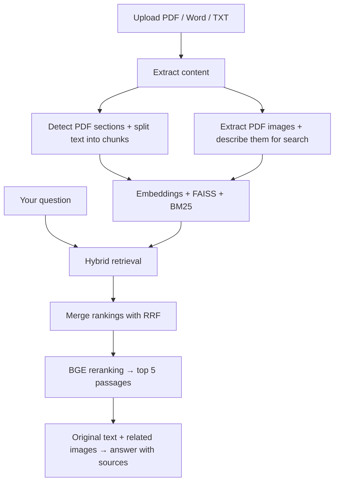

# Madar | Advanced RAG

### Upload a file. Ask questions. No manual preprocessing.

The goal: demonstrate high-quality RAG retrieval and answers without manually cleaning, restructuring, or splitting your files beforehand.

**Upload → Train → Ask.** Madar handles document processing automatically.

**PDF · Word · TXT** | Hybrid search + reranking | PDF images & diagrams | Answers with sources

## How it works

More screenshots

*Real app UI with illustrative data and a preset answer. “Train” indexes your documents.*

[Get the app](https://github.com/HUSSAMX7/Advanced_RAG/tree/main) · [Setup & usage guide](docs/usage.md)
