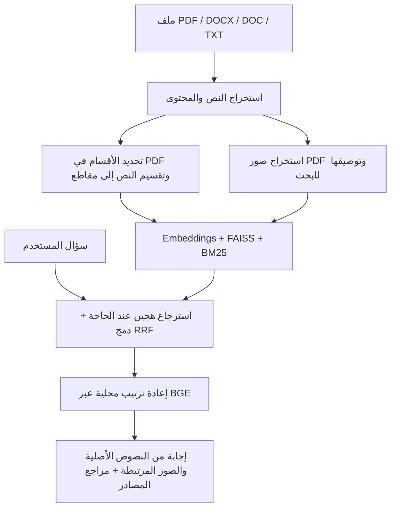

<div align="center">

# مدار | Advanced RAG

### ملفاتك كما هي. معرفة جاهزة للسؤال.

ارفع مستنداتك، اضغط «تدريب»، واسأل مساعدك بالعربية — مع الرجوع إلى المصدر.

**Arabic-first · PDF / Word / TXT · Hybrid Search · Multimodal RAG**

[ابدأ التشغيل](#التشغيل-السريع) · [شاهد التطبيق](#من-داخل-التطبيق) · [دليل الاستخدام](docs/usage.md) · [كود التطبيق](https://github.com/HUSSAMX7/Advanced_RAG/tree/develop)

</div>


## من الملف إلى الإجابة، بدون تجهيز يدوي

في أنظمة RAG، الوصول إلى إجابة مفيدة يبدأ قبل المحادثة: استخراج محتوى الملف، فهم أقسامه، تقسيمه إلى مقاطع، إنشاء embeddings، ثم بناء فهرس يمكن البحث فيه.

**مدار يتولى هذه الخطوات عنك.** لا تحتاج إلى استخراج النص بنفسك، أو تقسيم المستند يدويًا، أو كتابة سكربت معالجة لكل ملف. أضف الملف بصيغته المدعومة، ثم اضغط **تدريب**؛ يتولى النظام تجهيزه للبحث، وتتابع حالته من المكتبة حتى يظهر **تم التدريب**.

> **أنشئ مساعدًا ← ارفع ملفاتك ← اضغط «تدريب» ← اسأل وافتح المصادر.**
>
> «التدريب» هنا يعني معالجة الملف وفهرسته للاسترجاع، وليس إعادة تدريب نموذج اللغة أو تغيير أوزانه. رفع الملف وحده يحفظه؛ تبدأ المعالجة عند الضغط على «تدريب».

مثلًا: أضف دليل الموظف وسياسات الإجازات، ثم اسأل: **«كم يوم الإجازة السنوية؟ وكيف أقدم عليها؟»** يبحث المساعد في ملفاته عند الحاجة، ويعرض الإجابة مع مرجع تستطيع فتحه لمراجعة المقطع المستخدم.

## من داخل التطبيق

الصور التالية لقطات من واجهة التطبيق الفعلية، بملفات ومحادثة توضيحية مجهّزة محليًا. الإجابة المعروضة مثال ثابت لشرح التجربة، وليست تقييمًا لجودة النموذج.

### مساحة مستقلة لكل معرفة

أنشئ مساعدًا للموارد البشرية، وآخر للأبحاث أو المشاريع. لكل مساعد مكتبته وفهرسه ومحادثاته وتعليمات إجابته الخاصة.


### أضف الملف واترك التجهيز للنظام

اسحب ملفات **PDF وDOCX وDOC وTXT** إلى المكتبة. اضغط «تدريب» لمتابعة الاستخراج والتقسيم وإنشاء المتجهات وحفظها. يمكنك إيقاف المعالجة، أو إزالة الفهرسة مع الاحتفاظ بالأصل، أو حذف الملف.


### ارجع إلى الدليل وراء الإجابة

تظهر المصادر تحت الإجابة باسم الملف ورقم الصفحة عند توفره. افتح المصدر لقراءة المقطع المستخدم وتنزيل الأصل، أو عرض الصور المرتبطة بالمقطع وتكبيرها في ملفات PDF المدعومة.


## ما الذي يقدمه مدار؟

| الميزة | كيف تفيدك؟ |
| --- | --- |
| **تجهيز المستندات تلقائيًا** | استخراج المحتوى وتقسيمه وفهرسته من مسار واحد داخل التطبيق. |
| **واجهة عربية واتجاه RTL** | إدارة المساعدين والمكتبة والمحادثات والإعدادات بالعربية. |
| **بحث هجين مع إعادة ترتيب** | يجمع البحث الدلالي بـFAISS والبحث بالكلمات بـBM25، ويدمج النتائج بـRRF ثم يعيد ترتيبها محليًا عبر BGE. |
| **مصادر قابلة للمراجعة** | يعرض مرجع الملف والصفحة إن وجدت، مع المقطع المستخدم في الإجابة. |
| **صور ورسومات PDF** | يستخرج الصور أثناء المعالجة ويولّد أوصافًا للبحث؛ تصل النصوص الأصلية والصور المرتبطة بها إلى نموذج الإجابة. |
| **اختيار طريقة استخراج PDF** | LlamaParse أو LightOnOCR محلي، من إعدادات التطبيق. |
| **مساعدون مستقلون** | ملفات وفهرس ومحادثات وتعليمات منفصلة لكل مساعد. |
| **محادثات مستمرة** | حفظ المحادثات، وتوليد عناوينها، وتلخيص تاريخها القديم عند اقتراب سعة السياق. |
| **حساب أو جلسة ضيف** | دخول اختياري بالإيميل عبر Supabase Auth، مع بيانات وإعدادات منفصلة لكل حساب أو ضيف. |
| **إدارة المفاتيح من الواجهة** | مفاتيح خاصة بكل مستخدم، محفوظة مشفّرة، مع تطبيق الإعدادات بعد الحفظ. |

## كيف يعمل؟



يسترجع البحث مرشحين من المتجهات والكلمات، ثم يعيد ترتيبهم قبل إرسال أفضل المقاطع إلى نموذج الإجابة. أوصاف الصور تساعد في العثور عليها؛ يُرسل الدليل الأصلي إلى نموذج الإجابة. إذا لم يتضح ارتباط الشكل بالنص، تُرفق صورة الصفحة كاملة.

## التشغيل السريع

**نسخة التطبيق الموضحة هنا موجودة في فرع [`develop`](https://github.com/HUSSAMX7/Advanced_RAG/tree/develop).** استخدمه عند تنزيل المشروع؛ فرع `main` يحتوي حاليًا على الهيكل الأولي وهذا التوثيق.

تحتاج إلى **Python 3.13+** و**uv** و**Node.js 20.19+ أو 22.12+** لبناء الواجهة.

```powershell
git clone --branch develop https://github.com/HUSSAMX7/Advanced_RAG.git
cd Advanced_RAG
uv sync
Copy-Item .env.example .env
npm --prefix frontend ci
npm --prefix frontend run build
uv run advanced-rag-web
```

افتح **[http://127.0.0.1:8001](http://127.0.0.1:8001)**، ثم:

1. تابع كضيف، أو ادخل بإيميلك بعد إعداد [Supabase Auth](https://github.com/HUSSAMX7/Advanced_RAG/blob/develop/docs/setup-email-signin.md).
2. من **إعداداتي**، أضف مفتاح OpenAI واختر الموديلات. لملفات PDF اختر LlamaParse وأضف مفتاحه، أو اختر LightOnOCR المحلي.
3. أنشئ مساعدًا وافتح مكتبته، ثم ارفع ملفاتك واضغط **تدريب** لكل ملف.
4. عندما تظهر **تم التدريب**، انتقل للشات واسأل عن محتوى ملفاتك.

الإعدادات الأخرى وأوامر CLI وخيارات النشر والتخزين موضّحة في [دليل الاستخدام والتشغيل](docs/usage.md).

## الصيغ ومتطلبات المعالجة

| الصيغة | ما الذي يتولاه النظام؟ | المطلوب |
| --- | --- | --- |
| PDF | استخراج النص والأقسام، ومعالجة الصور والرسومات للملفات الداعمة للصور. | LlamaParse بمفتاحه أو LightOnOCR المحلي، مع OpenAI؛ معالجة الصور تحتاج نموذجًا يدعم الرؤية. |
| DOCX | قراءة الفقرات والجداول بترتيبها في المستند، ثم التقسيم والفهرسة. | OpenAI للـembeddings والمحادثة. الصور المضمنة في Word لا تُستخرج. |
| DOC | تحويل الملف تلقائيًا إلى DOCX، ثم معالجته. | LibreOffice مثبت محليًا، إضافةً إلى OpenAI. |
| TXT | قراءة النص وتقسيمه وفهرسته. | ترميز UTF-8، مع OpenAI. |

LightOnOCR يجعل **استخراج PDF** محليًا؛ المحادثة والـembeddings وتحديد الأقسام ووصف الصور ما زالت تستخدم OpenAI. أداء الاستخراج ودقته يعتمدان على جودة الملف ومزوّد الاستخراج؛ راجع [تفاصيل التشغيل وحدوده](docs/usage.md) عند اختيار المزوّد.

## التقنية والتوثيق

| الجزء | التقنيات |
| --- | --- |
| الواجهة | React · TypeScript · Vite · CSS RTL |
| الخادم | Python · FastAPI · SQLite |
| المعالجة والاسترجاع | LlamaIndex · FAISS · BM25 · BGE · OpenAI SDK |
| الاستخراج | LlamaParse · LightOnOCR · PyMuPDF · python-docx |
| الهوية وتخزين الأصول | Supabase Auth · Supabase Storage عند إعداده |

الأصول يمكن حفظها في Supabase Storage الخاص؛ معلومات الملفات والفهارس والمحادثات والصور المستخرجة ما زالت محلية. الخادم يعمل بعامل تشغيل واحد. تفاصيل الحالة الحالية في [تخزين الملفات](https://github.com/HUSSAMX7/Advanced_RAG/blob/develop/docs/specs/supabase-storage.md) و[جاهزية الإنتاج](https://github.com/HUSSAMX7/Advanced_RAG/blob/develop/docs/specs/production-readiness.md).

- [دليل الاستخدام والتشغيل وCLI](docs/usage.md)
- [هيكلة المشروع واتفاقيات الباكند](https://github.com/HUSSAMX7/Advanced_RAG/blob/develop/docs/architecture.md)
- [تصميم البحث والإيجنت](https://github.com/HUSSAMX7/Advanced_RAG/blob/develop/docs/specs/retrieval-agent.md)
- [دعم الصور في PDF](https://github.com/HUSSAMX7/Advanced_RAG/blob/develop/docs/specs/multimodal-rag.md)
- [الحسابات وجلسات الضيف](https://github.com/HUSSAMX7/Advanced_RAG/blob/develop/docs/specs/identity-and-guest-sessions.md)
