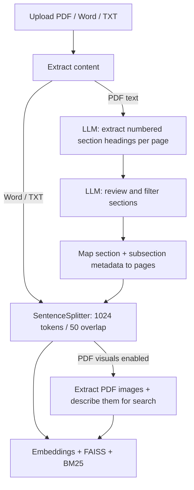
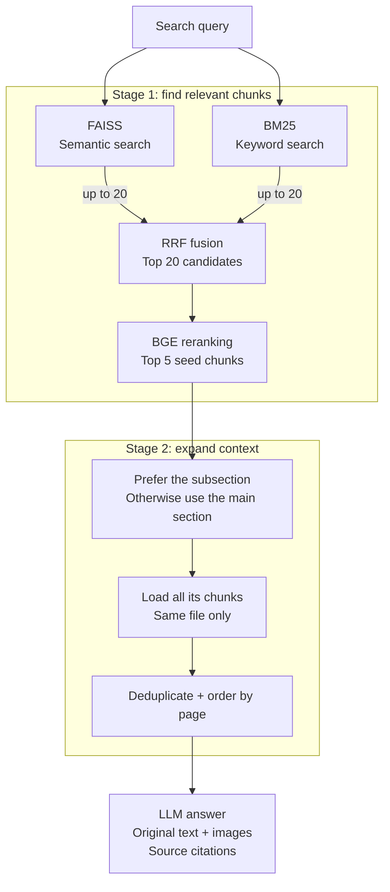

# Madar | Advanced RAG

### Upload a file. Ask questions. No manual preprocessing.

The goal: demonstrate high-quality RAG retrieval and answers without manually cleaning, restructuring, or splitting your files beforehand.

**Upload → Train → Ask.** Madar handles document processing automatically.

**PDF · Word · TXT** | Hybrid search + section expansion | PDF images & diagrams | Answers with sources

## Chunking process

PDF chunks inherit page and section metadata; headings do not define chunk boundaries.

## Retrieval process

Find relevant chunks first, then expand to their full subsection or main section from the same file.
Defaults: 20 candidates and 5 seed chunks; expanded context can contain more passages.
See [section expansion](docs/specs/section-expansion.md) for fallback behavior and limits.

More screenshots

*Real app UI with illustrative data and a preset answer. “Train” indexes your documents.*

[Get the app](https://github.com/HUSSAMX7/RAG_Everything/tree/main) · [Setup & usage guide](docs/usage.md)
